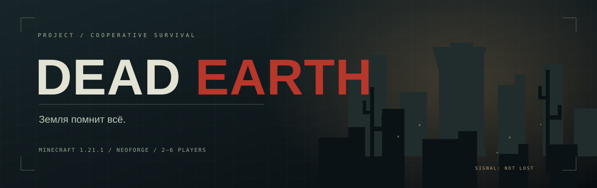
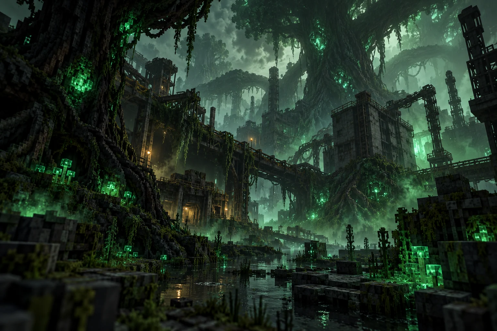
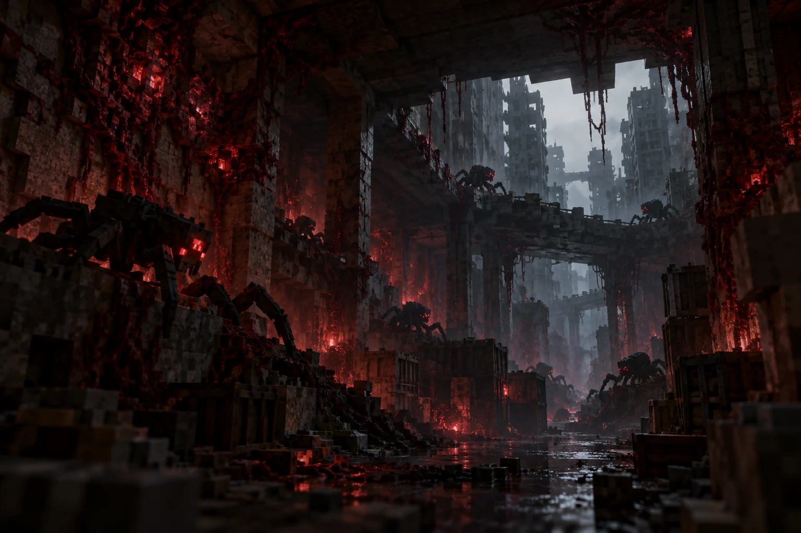

> **DEAD EARTH SRP 1.0.0 / Minecraft 1.12.2:** состав и установка — `legacy/README-PORT.md`; версии — `legacy/metadata/full.mods.lock.json`; карта замен — `legacy/metadata/mod-map.json`. Ниже сохранена документация исходной modern-сборки.

<p align="center">
  <a href="https://vlashex.github.io/HBM-Bunker/"></a>
</p>

<p align="center"><strong>Постъядерное выживание. Две враждебные биосферы. Одна команда.</strong></p>
<p align="center">Minecraft <b>1.21.1</b> · NeoForge <b>21.1.262</b> · Java <b>21</b> · Кооператив <b>2–6 игроков</b></p>
<p align="center">
  <a href="https://vlashex.github.io/HBM-Bunker/"><b>Сайт проекта ↗</b></a> &nbsp; / &nbsp;
  <a href="#быстрый-старт">Установка</a> &nbsp; / &nbsp;
  <a href="docs/releases/5.5.2.md">Версия 5.5.2</a> &nbsp; / &nbsp;
  <a href="docs/DEAD-EARTH-ROADMAP.md">Roadmap</a> &nbsp; / &nbsp;
  <a href="CHANGELOG.md">История версий</a>
</p>

---

## Мир, который уже умер

Снаружи — пепел, кратеры, камень и мёртвые стволы. Внизу — ваш бункер, первые запасы и шанс построить автономную базу. Но пустошь не останется пустой: лес захватывает поверхность, заражённые развиваются, а смена сезонов каждый раз меняет правила выживания.

**DEAD EARTH** — развивающаяся сборка на основе HBM с собственным координатором кампании, адаптивной сложностью и ограниченным локальным ИИ-режиссёром. Историческое имя репозитория — HBM Bunker.

<table>
<tr><td width="50%"></td><td width="50%"></td></tr>
<tr><td><b>Лес забирает землю</b><br>Overgrown Vegetation меняет ландшафт, распространяет споры и развивается по фазам.</td><td><b>Паразиты находят слабости</b><br>Mutationcraft, сезонные усиления и сценарии давления на периметр.</td></tr>
</table>

<sub>Иллюстрации — концепт-арт проекта, не игровые скриншоты.</sub>

## Что делает кампанию другой

| Система | В игре |
| :--- | :--- |
| **HBM — основа производства** | Металлургия, смешанные рецепты и технологическая прогрессия; дешёвые обходы стали и пластин закрыты. |
| **Пустошь** | Инертный пепел, кратеры и голые стволы; постройки HBM сохранены, обычные наземные ванильные постройки отключены. Генератор не добавляет радиационный фон. |
| **Жара и пепельная зима** | Огонь, дымка, холодный туман, толстая наледь и снег. Часы кампании стоят без игроков. |
| **Адаптивная сложность** | Развитие биосфер, здоровье и урон зависят от статистики команды; пределы и коэффициенты задаёт серверный конфиг. |
| **Эволюция паразитов** | Шесть фаз, постепенное открытие 43 видов и способностей, пауза развития без игроков, фазовые волны и управление −/+ в админке. [Правила](docs/DEAD-EARTH-EVOLUTION.md). |
| **Зоны и оборона** | Загрузчики формируют зоны; физические запасы сундуков/ME и состояние турелей участвуют в оценке ценности. |
| **Защитные материалы** | Стены, двери и люки V1/V2/V3: 1000/2000/8000 HP, крафты Reinforcer/HBM и устойчивость V3 к гнили. [Рецепты и настройки](docs/DEFENSE-MATERIALS.md). |
| **Интерактивный режиссёр** | 15 событий, 103 звука и 48 паттернов следов. Игрок реагирует на предвестник — сервер выбирает следующую ветку. |
| **Одна или две модели** | CPU-режиссёр4B, опциональный критик2B и один пересмотр в общем временном бюджете. [Настройки](docs/DEAD-EARTH-COUNCIL.md). |
| **Аналитика событий** | Фактический HP-урон, смерти, очки, реакции на следы и сигналы, таймлайн и графики в админке. [Метрики](docs/DEAD-EARTH-EVENT-ANALYTICS.md). |
| **Автоматизация** | Mystical Agriculture, Botany Pots, Ex Deorum, RFTools Utility и AE2. ProjectE упрощает обмен сырья, сохраняя технологическую прогрессию. |
| **Еда и вода** | Farmer's Delight и Thirst Was Reclaimed: кухня, овощи, супы, умеренная жажда и очистка воды. Первые культуры доступны через сита и простые рецепты. |
| **Добыча без Tinkers** | Just Hammers и Mining Gadgets с рецептами HBM; книги Эффективности X, Удачи V и Прочности V. |
| **Общий старт** | Один запас на всю команду: 6 загрузчиков зон, 256 земли и по 4 посадочных предмета восьми обычных деревьев. |
| **Мягкое начало** | Защита стартового бункера первые 3 часа кампании, плавная сложность 0.1 → 1 за час, замедленная эволюция паразитов. |
| **Лёгкий клиент** | Сортировка, Jade и рамка блока; Sodium, FerriteCore/ModernFix. С 5.3.1 шейдер и Iris удалены. |
| **Локальная админка** | Решения модели, графики, очередь, ручной запуск событий, конструктор сценариев и консоль человека. |

[Нагрузочные измерения →](docs/performance/2026-10-18-load-test.md): реальные
чанки, несколько видов паразитов, движение, склады и JFR. Отчёт относится к
5.2.0; новый защитный срез не участвовал в этих замерах.

### У каждого сезона свой противник

| | ☀ Жара | ◌ Затишье | ❄ Пепельная зима |
| :--- | :---: | :---: | :---: |
| **Паразиты** | ×0.5 | ×1.0 | ×1.8 |
| **Лес** | ×1.5 | ×1.0 | ×0.25 |
| **Поверхность** | Огонь и сухая дымка | Обычная погода | Толстый лёд и снег |

Сезонный множитель паразитов затрагивает также здоровье и урон. Это коэффициенты механик, а не обещание ровно такого количества мобов в короткой случайной выборке. [Подробности сезонов →](docs/DEAD-EARTH-SEASONS.md)

### ИИ выбирает постановку. Сервер контролирует исполнение.

Сервер оценивает доступные зоны, оборону и давление, затем предлагает допустимые события. Локальная CPU-модель выбирает вариант. Проверки, бюджет, реакции, очередь и сохранения остаются за кодом. Недоступность модели включает резервный выбор.

В режиме `dual` критик проверяет предложение, после чего основная модель может
один раз пересмотреть выбор. Обе загружаются последовательно в одном контейнере.
Модели выбирают событие из каталога; полный граф шагов пока задаётся шаблоном.
Первый [QLoRA-эксперимент](verification/director-training/README.md) завершён,
но ухудшивший оценку адаптер отклонён; рабочая модель сохранена.

Новые сочетания предвестников и реакций описываются JSON-графами без пересборки Java. В MCP нет произвольной консоли; полные команды доступны только человеку в админке. [События и тактики →](docs/DEAD-EARTH-CINEMATIC.md) · [Архитектура режиссёра →](director/README.md)

## Быстрый старт

Текущий локальный срез — **5.4.0**, собственный координатор — **4.3.0**. В клиенте 36 внешних модов и 2 собственных JAR: всего **38**. Серверный набор — **36 JAR**. MakeUp и Iris удалены; Sodium остаётся на клиенте.

> Актуальный выпуск: [DEAD EARTH 5.5.2](https://github.com/Vlashex/HBM-Bunker/releases/tag/v5.5.2). Клиенты Prism и TLauncher, фазы эволюции, аналитика и режимы ИИ; шейдеров/Iris нет.

1. Получите `HBM-Bunker-5.4.0-Prism.zip` из локального релиза или соберите его по инструкции ниже.
2. В PrismLauncher выберите **Добавить экземпляр → Импорт** и укажите ZIP.
3. Используйте **Java 21**, выделите клиенту **6 ГБ** памяти.
4. Для кооператива подготовьте отдельный сервер той же версии. Инструкция по обновлению и ограничения — в [описании выпуска](docs/releases/5.4.0.md).

### Сервер и админка

На уже подготовленном локальном окружении Windows:

```bat
start-dead-earth.bat
start-dead-earth.bat status
start-admin.bat
```

Панель: **http://127.0.0.1:8765**. Вкладка «Консоль сервера» показывает живой журнал и принимает команды через локальный RCON. Во вкладке «Постановка» можно запускать отдельные события и собирать собственные сценарии; требуется координатор4.1.0 на игровом сервере.

Запускатель рассчитан на настроенный сервер в соседней папке и его `deployment.json`; это ещё не автоматический установщик для чистого ПК. ИИ использует Docker с CPU-моделью. [Локальный запуск →](docs/LOCAL-LAUNCHER.md) · [Админка и RCON →](docs/DEAD-EARTH-ADMIN.md)

## Документация

| Игровые системы | Разработка и управление |
| :--- | :--- |
| [Пустошь и генерация](docs/DEAD-EARTH-WASTELAND.md) | [Координатор и часы кампании](docs/DEAD-EARTH-FOUNDATION.md) |
| [Сезоны и наледь](docs/DEAD-EARTH-SEASONS.md) | [Локальный режиссёр](director/README.md) |
| [Адаптивная сложность](docs/DEAD-EARTH-ADAPTIVE.md) | [MCP-мост](docs/DEAD-EARTH-MCP-BRIDGE.md) |
| [Ценность зон и турели](docs/DEAD-EARTH-ZONES.md) | [Каталог событий и реакции](docs/DEAD-EARTH-CINEMATIC.md) |
| [Общий запас в бункере](docs/DEAD-EARTH-STARTER.md) | [Админка и консоль](docs/DEAD-EARTH-ADMIN.md) |
| [Еда и вода](docs/FOOD-WATER.md) | [Выпуск 5.2.0](docs/releases/5.2.0.md) |
| [Баланс, крафты и EMC](docs/BALANCE.md) | [Сайт и GitHub Pages](docs/WEBSITE.md) |
| [Известные ограничения](docs/KNOWN-ISSUES.md) | [Участие в разработке](CONTRIBUTING.md) |

## Сборка из исходников

Для упаковщика нужен Python **3.11+** без сторонних библиотек. Для собственного Java-мода — Java **21**; для MCP/режиссёра — отдельный Python **3.12** с закреплёнными зависимостями в `director/`.

Сначала соберите координатор по [Foundation](docs/DEAD-EARTH-FOUNDATION.md): его JAR должен соответствовать размеру, версии и SHA-256 в `metadata/own-mods.lock.json`. Затем из корня:

```sh
python -m unittest discover -s tests -v
python tools/release.py check
python tools/release.py fetch
python tools/release.py build
```

`fetch` загружает только закреплённые моды и проверяет хеши. `build` создаёт Prism ZIP, собственные JAR и `SHA256SUMS.txt` в `dist/`. Миры, аккаунты, токены, кеши и готовые архивы в Git не хранятся.

<details>
<summary><b>Карта репозитория</b></summary>

| Путь | Назначение |
| :--- | :--- |
| `mods/dead-earth/` | Java-координатор: кампания, климат, адаптеры биосфер, зоны и сценарии |
| `director/` | MCP gateway, CPU-модель, журнал и локальная админка |
| `pack/patch/` | Рецепты, теги, зачарования и данные патча |
| `pack/config/` | Конфиги сборки и JSON-каталог событий |
| `metadata/` | Точные версии, контрольные суммы и справочные списки |
| `tools/` · `tests/` | Упаковка и проверки |
| `docs/` | Документация и статический сайт GitHub Pages |
| `verification/` | Свидетельства конкретных проверок и их ограничения |

</details>

## Проверки

| Срез | Подтверждённый результат | Свидетельство |
| :--- | :--- | :--- |
| Координатор 4.2.0 / релиз 5.3.0 | 187 Java unit /111 GameTest, настоящий клиент: 9 предметов /387 состояний, Iris; 3744 V1 в новом стартовом бункере | [Защитные материалы](verification/defense-materials/README.md) |
| Координатор 4.1.1 / релиз 5.2.0 | 180 Java unit / 94 GameTest, 16 тестов упаковщика; вода, супы, ранние культуры и запрет дикорастущих культур | [Еда и вода](verification/food-water/README.md) |
| Координатор 4.1.0 / релиз 5.1.0 | 180 Java unit / 90 GameTest, 59 Python-тестов, два DOM-набора, 16 тестов упаковщика и настоящий HTTP → RCON | [Постановка событий](verification/admin-authoring/README.md) |
| Координатор 4.0.0 / релиз 5.0.0 | 164 Java unit / 85 GameTest, 16 проверок упаковщика; отдельный сервер и настоящий клиент с активным MakeUp | [Проверки v5](verification/v5/checks-5.0.0.json) |
| Координатор 3.3.0 / релиз 4.2.0 | 154 Java unit / 76 full-pack GameTest, отдельный мир | [Стартовый запас и общий прогон](verification/starter/checks-4.2.0.json) |
| Админка / релиз 4.3.0 | 48 Python-тестов, 13 проверок упаковщика, DOM-проверка; настоящие `list`/`help` через RCON | [Консоль 4.3.0](verification/admin/console-4.3.0.json) |
| Исходный баланс MVP | Крафты, EMC, сита и 4096 разрушений руды плоскостями AE2 | [Исторические проверки MVP](verification/mvp/repository-migration.json) |

Результаты относятся к указанным срезам. Проверка сохранённого отчёта и тесты упаковщика не заменяют запуск Minecraft. Новые игровые изменения проверяются отдельными прогонами.

---

<p align="center"><b>Выжить. Адаптироваться. Вернуть Землю.</b><br><sub>Независимый проект Minecraft. Не связан с Mojang или Microsoft.<br>Права на сторонние моды сохраняются за их авторами: <a href="THIRD-PARTY.md">источники и лицензии</a>.</sub></p>
