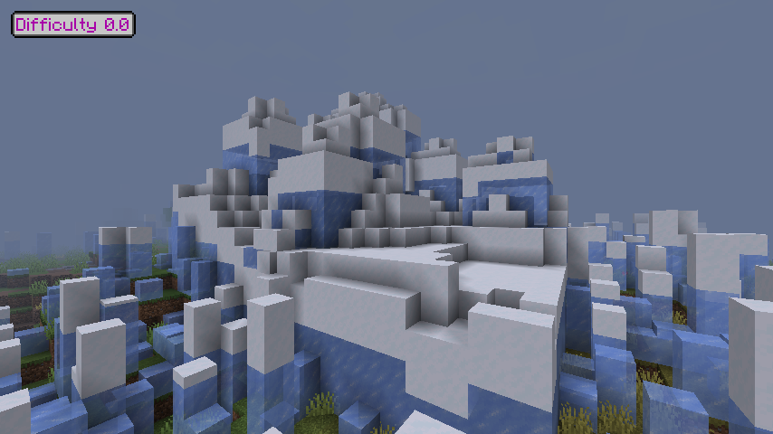
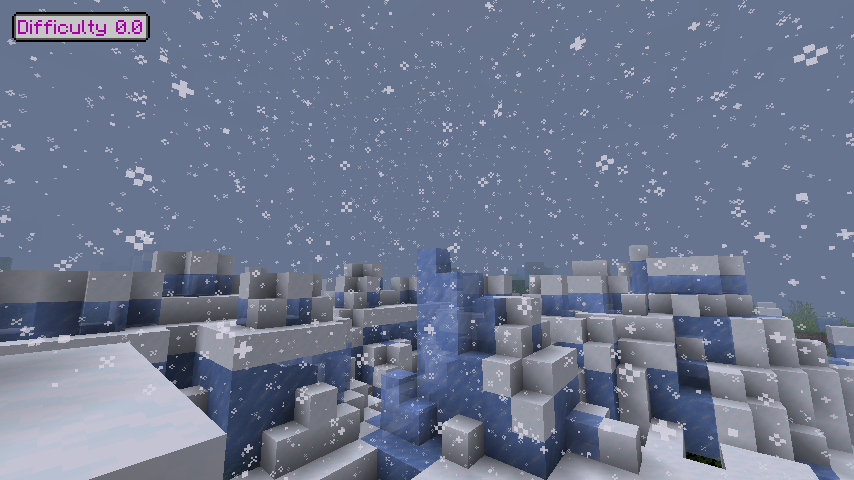

# Проверка зимнего патча 2.0.1

17 октября 2026: 103 Java-теста и 49 игровых проверок полного состава модов
пройдены. Игровой прогон занял 17,35 с после запуска стенда. Проверены верх и
бока, грунт под листвой, высокие деревья, защита помещений/контейнеров/сущностей,
постепенный рост и оттепель, отказ бюджета с последующим продолжением,
выгруженные соседи и детерминированный рельеф новой зимы.

Реальный клиент подключён к отдельному серверу на этом ПК. Снимки ниже сделаны
в обычном лесу тестового мира: это блоки игры, не визуализация и не монтаж.
Для съёмки область поставлена в очередь тестовой командой; скорость роста и
пределы изменений оставались обычными. Ускоренные серверные тики сокращали
ожидание. Пользовательские миры и профили Prism не изменялись.

По умолчанию: до 24 изменений блоков, двух изменённых секций и 2048 проверяемых
вертикальных ячеек за тик; 16 новых колонок и ограниченная очередь повторов.
Глубина до 384 блоков охватывает высокие деревья, но сканирование прекращается
на наружном грунте. Погода не создаёт tickets. Не загруженные чанки сохраняют
состояние, а после загрузки постепенно приводятся к текущему сезону.

В полном составе модов ускоренные 9000 тиков заняли в среднем 5,54 мс/тик на
прогоне до последнего расширения глубины и лимита ячеек. Это наблюдение для
одного стенда, не сравнение производительности версий. Последняя настройка
глубины и бюджета отдельно прошла все 49 игровых проверок и короткое
подключение клиента. Окно клиента 854×480, ограничение 40 FPS; результат не
доказывает производительность в высоком разрешении или с шестью игроками.

Карта высот версии алгоритма 1 зависит от seed мира и сохранённого номера
климатического цикла. Не выделяется карта всех чанков. Порядок загрузки и
перезапуск не меняют рисунок текущей зимы. Пики имеют ограниченную ширину и
высоту; снеговая шапка на вершинах выключена по умолчанию. Числа и пределы
доступны в [примере серверного конфига](../../docs/examples/dead-earth-server.toml).

Обычная трава/папоротники, погребённые покрытием, не отрастают автоматически.
Прочие растения модов и саженцы не заменяются. Большая активная область
покрывается дольше; полная обработка всех чанков за одну зиму не гарантируется.

[Машиночитаемые результаты](summary.json).
