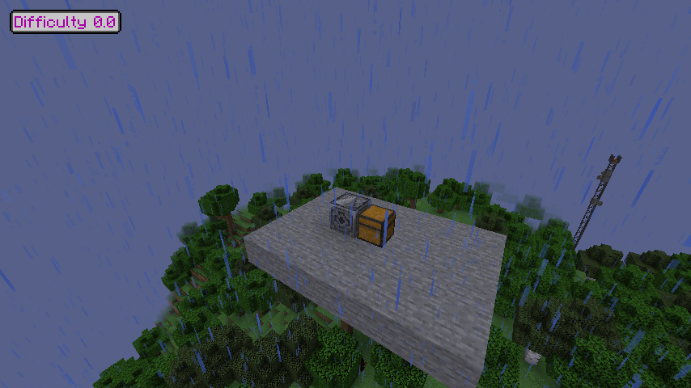

# Проверка зон v3

17 октября 2026: 109 Java-тестов и 58 игровых проверок полного состава модов
пройдены. Игровой прогон занял 23,22 с после запуска. Python gateway: 12 тестов.
Проверки упаковки: 13 тестов.

Подтверждены реальные ticking tickets загрузчика без игроков, объединение двух
областей в 12 чанков, независимое снятие tickets при удалении одного блока,
защита нераскрытого loot и отсутствие загрузки недостающих чанков сканером.
Реальные ячейки AE2 читаются без питания, включая буферизированные изменения,
без записи компонентов живой ячейки. Повреждённые, повторные и неположительные
записи отклоняются как UNKNOWN. Нативные HBM Sentry и внутренний магазин Howard
различают боезапас/питание/выключение без расходования предметов.

Индекс SecurityCraft проверен на появлении, перемещении, удалении и ограничении
кандидатов. Сканер не использует запрос всех сущностей/глобальных multipart
сущностей. ProjectE проверен на единичной цене алмаза 8192 и нулевом EMC загрузчика.
Отдельная регрессия подтверждает UNKNOWN до готовности нативной таблицы цен.

После настоящего перезапуска без игроков восстановлены два загрузчика и тот же
ID зоны. Сундук сохранил четыре алмаза. Когда ProjectE готов, наблюдаемый запас
равен 32768 EMC, а вклад ресурсов — 3,2768 при коэффициенте 0,0001. В этих же
чанках есть три естественных контейнера с неизвестным содержимым: они не
выданы за пустые, весь отчёт честно остаётся `complete=false`. Никакой loot ради
замера не раскрывался. До первого подключения цены были UNKNOWN, после
подключения таблица ProjectE готова, и неизвестные цены исчезли.

Реальный клиент 3.0.0 подключён к выделенному серверу: проверены название,
модель и подсказка загрузчика, серверный коэффициент 0,0001 и синхронизация
нестандартных настроек кампании. Кадр ниже сделан в этом тестовом мире.
Исправлен поиск обработчиков Ponder при ограниченном загрузчике фонового потока;
это проверено настоящим повторным запуском клиента. Игровые классы и ресурсы
сервера побайтно совпадают с выпуском; разница допустима только в двух классах
изолированных тестовых fixtures. Все 58 тестов запускались с окончательными fixtures.

Пользовательские миры/профили Prism не изменялись. Нет проверки нагрузки на
шести игроках или с ИИ; окно клиента 854×480 с ограничением 40 FPS. Наблюдения
инкрементальны, не являются транзакцией всех хранилищ. Поддерживаемые контейнеры,
ячейки и турели перечислены в [руководстве](../../docs/DEAD-EARTH-ZONES.md).
Выбор атак ИИ ещё не реализован. Зимний патч 2.0.1 включён;
[настоящий кадр леса](../winter-2.0.1/forest-canopy.png).

[Машиночитаемые результаты](summary.json).
